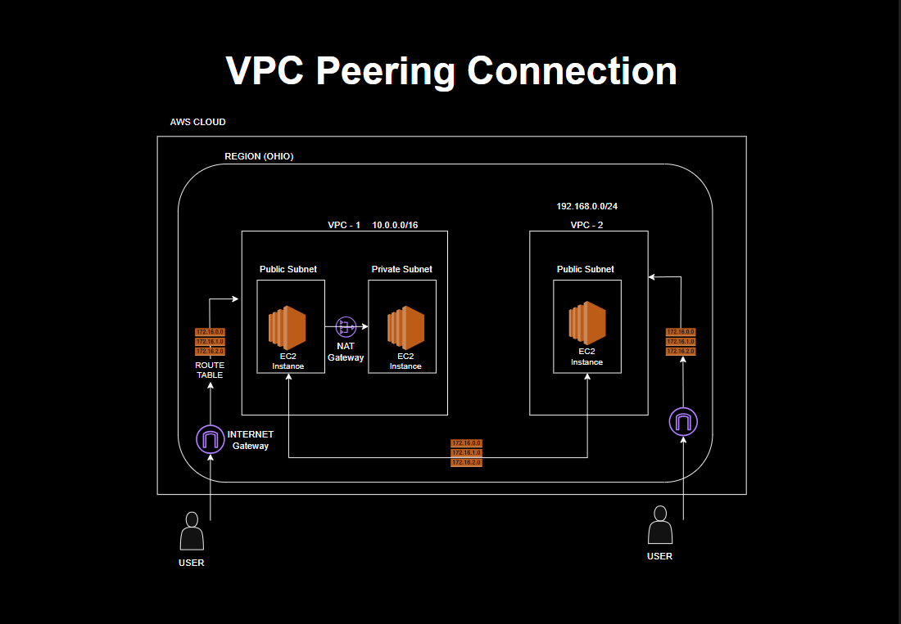

# AWS VPC Peering: Step-by-Step Demonstration

This project demonstrates how to connect two isolated Amazon Virtual Private Clouds (VPCs) with **VPC Peering**. The configuration uses separate production and test networks, route tables, security groups, EC2 instances, and a NAT Gateway for private-subnet internet access.

VPC peering provides private, point-to-point connectivity between two VPCs. It does not merge the VPCs: each VPC keeps its own subnets, route tables, and security controls.

## Architecture



The screenshots in this repository were captured from the AWS Management Console. Names, IDs, IP addresses, and Availability Zones may differ in another AWS account.

## What this project creates

- A production VPC (`Prod-VPC`)
- A test VPC (`Test-VPC`)
- Non-overlapping CIDR blocks for both VPCs
- Public and private subnets
- Internet Gateway and NAT Gateway resources
- EC2 instances for connectivity testing
- A VPC peering connection between the two VPCs
- Routes in both VPCs that point to the peering connection
- Security group rules that allow the required private traffic

## AWS services used

| Service | Purpose |
| --- | --- |
| Amazon VPC | Isolated virtual networks |
| Amazon EC2 | Test instances in the VPCs |
| VPC Peering | Private traffic between the VPCs |
| Route Tables | Direct traffic to the correct gateway or peering connection |
| Internet Gateway | Internet access for public subnets |
| NAT Gateway | Outbound internet access for private subnets |
| Elastic IP | Public IP address associated with the NAT Gateway |
| Security Groups | Instance-level traffic control |
| Cost Explorer | Cost and usage monitoring |

## Prerequisites

1. An AWS account and permission to create VPC, EC2, Elastic IP, and networking resources.
2. An AWS Region selected in the AWS Management Console.
3. Two **non-overlapping** VPC CIDR blocks. For example:
   - `Prod-VPC`: `10.0.0.0/16`
   - `Test-VPC`: `10.1.0.0/16`
4. An EC2 key pair and an Amazon Linux security update path suitable for your account.

> Do not use overlapping VPC CIDR blocks. AWS cannot route traffic between peered VPCs when their address ranges overlap.

## Step 1: Create the two VPCs

1. Open **VPC Console > Your VPCs > Create VPC**.
2. Create `Prod-VPC` with one CIDR block, such as `10.0.0.0/16`.
3. Create `Test-VPC` with a different CIDR block, such as `10.1.0.0/16`.
4. Confirm that both VPCs are in the same Region unless you intentionally want a cross-Region peering connection.

## Step 2: Create subnets

Create at least one public and one private subnet in each VPC. Example subnet ranges:

| VPC | Public subnet | Private subnet |
| --- | --- | --- |
| `Prod-VPC` | `10.0.1.0/24` | `10.0.2.0/24` |
| `Test-VPC` | `10.1.1.0/24` | `10.1.2.0/24` |

Use **VPC Console > Subnets > Create subnet**, select the correct VPC, and assign each subnet to an Availability Zone.


## Step 3: Configure Internet Gateways

1. Go to **VPC Console > Internet gateways > Create internet gateway**.
2. Create one Internet Gateway for each VPC.
3. Attach each Internet Gateway to its matching VPC.
4. Associate the public subnet route table with a default route (`0.0.0.0/0`) to that VPC's Internet Gateway.


## Step 4: Configure the NAT Gateway

A NAT Gateway allows instances in a private subnet to initiate outbound internet connections without accepting unsolicited inbound connections.

1. Allocate an Elastic IP in **VPC Console > Elastic IPs**.
2. Open **NAT gateways > Create NAT gateway**.
3. Select the public subnet in the VPC and associate the allocated Elastic IP.
4. Add `0.0.0.0/0` through the NAT Gateway to the private subnet route table.

NAT Gateways are billed resources. Create one only when private-subnet internet access is required.


## Step 5: Create EC2 instances

1. Launch an EC2 instance in the `Prod-VPC` subnet.
2. Launch another EC2 instance in the `Test-VPC` subnet.
3. Place the instances in the intended public or private subnet.
4. Record each instance's **private IPv4 address**. VPC peering traffic must use private IP addresses, not public IP addresses.
5. Confirm that the instances are running and that the correct security group is attached.


## Step 6: Configure security groups

Create or update the security groups attached to the two instances:

1. Allow SSH (`TCP 22`) only from your trusted administration address or bastion host.
2. Allow ICMP (or the application port you are testing) from the **remote VPC CIDR**, not from the public internet.
   - On the production instance, allow traffic from the `Test-VPC` CIDR.
   - On the test instance, allow traffic from the `Prod-VPC` CIDR.
3. Keep outbound rules restricted to the traffic required by the demonstration.

Security groups are stateful, but both sides still need rules that permit the intended traffic.


## Step 7: Create the VPC peering connection

1. Open **VPC Console > Peering connections > Create peering connection**.
2. Enter a name such as `Prod-to-Test`.
3. Select `Prod-VPC` as the requester VPC and `Test-VPC` as the accepter VPC.
4. Select the same Region and account when both VPCs are in this account. For a different account or Region, provide the required account and Region details.
5. Choose **Create peering connection**.
6. Select the new connection and choose **Actions > Accept request** from the accepter VPC account.
7. Wait until the peering connection state is **Active**.


## Step 8: Add routes on both sides

Peering is not transitive and does not automatically update route tables. Add a route in each VPC:

### Production route table

1. Open **VPC Console > Route tables** and select the route table associated with the production test subnet.
2. Choose **Edit routes > Add route**.
3. Set **Destination** to the complete `Test-VPC` CIDR, for example `10.1.0.0/16`.
4. Set **Target** to the active peering connection.
5. Save the route.


### Test route table

1. Select the route table associated with the test instance subnet.
2. Add a route whose destination is the complete `Prod-VPC` CIDR, for example `10.0.0.0/16`.
3. Select the same peering connection as the target.
4. Save the route.


Review the route tables to confirm the peering route appears on both sides:


## Step 9: Validate connectivity

1. Connect to the production instance using SSH, Session Manager, or your approved administration method.
2. From production, test the private IP address of the test instance:

   ```bash
   ping <test-instance-private-ip>
   ```

3. Connect to the test instance and test the private IP address of the production instance:

   ```bash
   ping <prod-instance-private-ip>
   ```

4. If ICMP is not enabled, test the application port instead, for example:

   ```bash
   nc -vz <remote-private-ip> <port>
   ```

5. Confirm that the response uses private addresses and that the route tables and security groups allow the traffic.


## Troubleshooting checklist

- The peering connection state is **Active**.
- The VPC CIDR blocks do not overlap.
- Both route tables contain a route to the other VPC CIDR through the peering connection.
- The instance subnets are associated with the route tables that were edited.
- Security groups allow the protocol and port from the remote VPC CIDR.
- Network ACLs allow the traffic in both directions.
- The instances are using private IP addresses for the test.
- The operating system firewall permits ICMP or the application port.
- A route through a peering connection is not transitive through another VPC, VPN, or gateway.

## Cost and cleanup

VPCs and route tables do not normally incur charges, but EC2 instances, NAT Gateways, Elastic IPs, and data transfer may. Review **Billing > Cost Explorer** during the exercise.

When finished, remove resources in this order:

1. Terminate the EC2 instances.
2. Delete the NAT Gateway.
3. Release unused Elastic IPs.
4. Delete the peering connection.
5. Delete subnets, route tables, Internet Gateways, and the VPCs.

## Key takeaways

- VPC peering enables private, point-to-point connectivity between two VPCs.
- Routes must be configured in both VPCs; accepting the peering request alone is not enough.
- Security groups and network ACLs still control whether traffic is allowed.
- VPC peering is not transitive.
- NAT Gateway costs can be significant for a short-lived lab, so clean up unused resources promptly.

## Project files

- [`Architecture/ARFINAL.png`](./Architecture/ARFINAL.png) - architecture diagram
- [`Screenshots/`](./Screenshots) - AWS console and connectivity screenshots

## Author

[Gayatri Warekar](https://github.com/gayatriwarekar)
